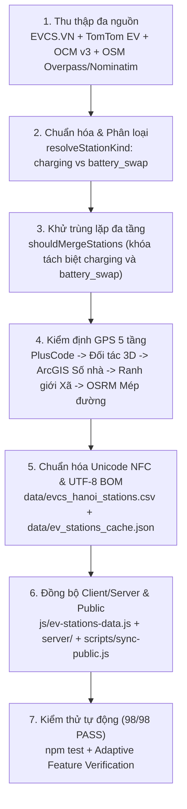

# BÁO CÁO QUY TRÌNH THU THẬP, KIỂM ĐỊNH GPS VÀ CHUẨN HÓA DỮ LIỆU MOVESAFE VN

Tài liệu này mô tả chi tiết quy trình thu thập (cào/đồng bộ), hợp nhất đa nguồn, kiểm định tọa độ GPS thực địa, phân loại trạm sạc / trạm đổi pin và đồng bộ lưu trữ đang vận hành trong hệ thống **MoveSafe VN**.

---

## 1. TỔNG QUAN KIẾN TRÚC NGUỒN DỮ LIỆU (MULTI-SOURCE PIPELINE)

Hệ thống MoveSafe VN tổ chức dữ liệu theo mô hình **Nguồn Sự Thật Duy Nhất (Single Source of Truth)** tại thư mục `data/`, đồng bộ tự động sang `js/`, `server/` và `public/`:

| Nhóm dữ liệu | Tệp đích chính | Nguồn thu thập | Tần suất / Cơ chế |
| :--- | :--- | :--- | :--- |
| **Kho thực địa EVCS Hà Nội & lân cận** | `data/evcs_hanoi_stations.json` `data/evcs_hanoi_stations.csv` | Tập dữ liệu gốc EVCS.VN kết hợp kiểm định đa nguồn (`evcs-phone-3d`, ArcGIS, TomTom, Photon/OSM, OSRM) | `1.141` trạm (`468` trạm sạc, `673` trạm đổi pin) |
| **Kho Trạm sạc & Đổi pin Toàn quốc** | `data/ev_stations_cache.json` `js/ev-stations-data.js` `server/ev-stations-data.js` | Hợp nhất 4 nguồn: EVCS.VN + TomTom EV Search + Open Charge Map v3 + OpenStreetMap (Overpass/Nominatim) | `1.353` trạm (`1.225` Hà Nội & giáp ranh, `98` TP.HCM, `30` Đà Nẵng), Cache TTL `6 giờ` |
| **Dữ liệu Ngập, Giao thông & Thời tiết** | `data/live_urban_cache.json` | VOV Giao thông (`vovgiaothong.vn`), TomTom Traffic Incidents v5, Open-Meteo Forecast v1 (`76` phường/xã Hà Nội), OpenWeatherMap, HSDC/UDiMaps, Cộng đồng | Bot tự động thu thập định kỳ trong `server/bot-service.js` |

---

## 2. QUY TRÌNH THU THẬP DỮ LIỆU ĐA NGUỒN

### 2.1. Thu thập Trạm sạc & Tủ đổi pin (`server/ev-service.js`)
Hàm `syncAllStations()` trong `server/ev-service.js` sử dụng cơ chế **Cache TTL 6 giờ** (`SYNC_INTERVAL_MS = 6 * 3600 * 1000`) kết hợp `apiQuotaGuard` để bảo vệ hạn mức API và giữ tốc độ phản hồi tức thì:

1. **Nguồn nền ưu tiên cao (Độ ưu tiên 4 — `EVCS.VN / MoveSafe VN`)**:
   - Đọc danh mục thực địa chuẩn hóa từ `data/evcs_hanoi_stations.json` và tập trạm curated trong `js/ev-stations-data.js`.
   - Các bản ghi có nguồn `evcs-phone-3d` mang tọa độ GPS thực địa từ bản đồ 3D của EVCS.VN (`592` trạm).
2. **TomTom EV Search API (Độ ưu tiên 3 — `api.tomtom.com/search/2/...`)**:
   - Gọi song song 5 vùng trọng điểm (`Hà Nội EV Category`, `Hà Nội VinFast EV`, `Xuân Mai - Hòa Lạc EV`, `TP.HCM EV Category`, `Đà Nẵng EV Category`, `limit=100`).
   - Lọc bỏ showroom thuần túy (`đại lý|showroom|bán xe|sửa chữa`) và trạm xăng không có trụ sạc.
   - Phân tách rõ tủ đổi pin e-Scooter (`stationKind: "battery_swap"`, `vehicleTypes: ["ebike"]`, `3.5kW`) với trạm sạc ô tô (`stationKind: "charging"`).
3. **Open Charge Map API v3 (Độ ưu tiên 2 — `api.openchargemap.io/v3/poi/`)**:
   - Truy vấn `countrycode=VN&maxresults=500&compact=true&verbose=false` với cơ chế xoay vòng API key qua `apiQuotaGuard`.
4. **OpenStreetMap Overpass API & Nominatim Fallback (Độ ưu tiên 1)**:
   - Truy vấn các đối tượng `nw["amenity"="charging_station"]` trên vùng Hà Nội, TP.HCM, Đà Nẵng qua `overpass-api.de` và `overpass.private.coffee`.
   - Nếu Overpass quá tải/timeout, tự động chuyển sang `nominatim.openstreetmap.org/search` (tuân thủ giới hạn `1 req/giây`).
   - Áp dụng gom cụm nội bộ `clusterOverpassStations()` trong bán kính `<= 60m` cùng hãng để gộp nhiều trụ đơn lẻ trong cùng bãi đỗ xe thành 1 trạm hoàn chỉnh (cộng dồn `totalPoints`, giữ `maxPowerKw` cao nhất).

### 2.2. Thu thập Dữ liệu Đô thị Thời gian thực (`server/bot-service.js`)
- **Tin tức giao thông & ngập lụt**: Thu thập từ `https://vovgiaothong.vn` bằng `axios` + `cheerio`, bóc tách tên đường/nút giao từ tiêu đề và đối chiếu tọa độ qua `CORE_INTERSECTIONS_GEO` và bộ từ điển 76 phường/xã Hà Nội (`js/hanoi-wards-streets.js`).
- **Sự cố giao thông TomTom**: Gọi `https://api.tomtom.com/traffic/services/5/incidentDetails` theo bounding box từng thành phố (`v5`).
- **Thời tiết đa trạm**: Truy vấn đồng loạt 76 phường/xã Hà Nội trong 1 HTTP request tới `https://api.open-meteo.com/v1/forecast` (kết hợp OpenWeatherMap khi khả dụng).

---

## 3. CÁC LỖI PHÁT HIỆN TRONG DỮ LIỆU GỐC & NGUYÊN NHÂN

Qua kiểm toán toàn bộ dữ liệu trước khi sửa (`audit_ev_positions.js` và kiểm tra đối chiếu thực địa), hệ thống phát hiện 4 nhóm lỗi nghiêm trọng:

1. **Tọa độ GPS bị dồn về tâm quận/huyện (Centroid Collision)**:
   - Trong `1.141` trạm EVCS ban đầu, có `549` trạm chưa có tọa độ `evcs-phone-3d` mà dùng kết quả geocode `google-maps` / `tomtom`. Nhiều truy vấn địa chỉ mơ hồ hoặc chứa tên phường/xã mới sau sáp nhập hành chính khiến geocode rơi về cùng 1 tâm quận/huyện: **253 trạm bị dồn trùng khít vào 90 tọa độ tâm** (ví dụ: 9 trạm ở Thạch Thất cùng 1 điểm, 8 trạm ở Sóc Sơn/Đông Anh cùng 1 điểm, 7 trạm ở Chương Mỹ cùng 1 điểm).
   - **45 trạm** nằm hoàn toàn ngoài ranh giới quận được gán; **109+ trạm** bị gán nhầm tên quận/khu vực (ví dụ: `236 Kim Mã` gán vào Thạch Thất, `83 Trường Chinh` gán vào Phú Xuyên, `406 Quảng Oai` gán vào Thạch Thất, `Nguyễn An Ninh - Tương Mai` gán vào Thường Tín).
2. **Ghim rơi vào trong nhà dân hoặc giữa sân bóng**:
   - Một số điểm geocode theo tên khu vực/tổ dân phố hoặc công trình (`Sân vận động`, `Sân bóng`, `Vỉa hè`, `Thôn`) lấy tọa độ tâm thửa đất hoặc tâm sân bóng (ví dụ điểm vỉa hè SVĐ Mỹ Đình bị đặt sâu `161m` vào giữa sân bóng, điểm `Bưu cục Vạn Thắng` cách đường `745m`, điểm `Hùng Anh Xuân Mai` rơi vào khu biệt thự Xa La Hà Đông).
   - Ngoài ra, cơ chế tách điểm trùng trên bản đồ (`js/map-engine.js`) trước đây đẩy vòng tròn bán kính `0.00014°` (~15m), vô tình đẩy ghim từ sân/vỉa hè vào nhà dân lân cận.
3. **Nhầm lẫn Trạm sạc ↔ Trạm đổi pin**:
   - `shouldMergeStations()` trong `server/ev-service.js` trước đây cho phép gộp mọi trạm cùng hãng VinFast trong bán kính `< 40m` mà không kiểm tra `stationKind`, làm **42 trạm** trong tập 167 trạm bị nuốt sang loại đối lập khi hợp nhất từ `evcs_hanoi_stations.json` vào `ev_stations_cache.json`.
   - **222 trạm** trong `ev_stations_cache.json` bị thiếu trường `stationKind` (bao gồm 13 tủ đổi pin Selex và `tt-hip-rk-YgCfHDtyI-USNUQ` bị gán nhầm `vehicleTypes: ['ebike', 'ecar']`).
   - Regex trong `js/map-engine.js` trước đây kiểm tra `/selex|đổi pin|trạm tđp/i.test(st.name)`, khiến **5 trạm siêu sạc 30kW–180kW** có kèm tủ đổi pin (như `AEON Mall Hà Đông 180kW`, `KCN Phú Nghĩa 150kW`) bị hiển thị thành ghim `"Đổi pin"` thay vì `"Siêu sạc"`.

---

## 4. QUY TRÌNH KIỂM ĐỊNH GPS 5 TẦNG & CHUẨN HÓA ĐÃ ÁP DỤNG

Quy trình tự động trong `scratch/verify_and_fix_ev_gps.js` và `scratch/fix_ev_gps_precision.js` thực thi tuần tự các bước kiểm chứng chặt chẽ (bảo toàn 100% các trạm tỉnh lân cận như Bắc Giang/Bắc Ninh, Hưng Yên với tọa độ chính xác):

1. **Sửa siêu dữ liệu Quận/Huyện & Địa chỉ sai lệch**:
   - Chuẩn hóa `district` và `area` cho **109 trạm** dựa trên mã trạm (`HNO_BVI`, `HNO_BTL`, `HNO_HBT`...), tên đường/phường trong địa chỉ và kiểm chứng khoảng cách với 76 phường/xã trong `js/hanoi-wards-streets.js`.
   - Khôi phục chính xác địa chỉ & tọa độ cho trạm ngoại tỉnh (`evcs-swap-feb2e8fd06` tại Thị trấn Kép, Lạng Giang, Bắc Giang: `21.407506, 106.281245`, cùng `TITAN BAC NINH` và `VinFast KM24 Yên Mỹ Hưng Yên`).
2. **Tầng 0 — Giải mã Plus Code (`OLC`)**:
   - Giải mã trực tiếp các địa chỉ chứa mã vị trí Google Plus Code (như `WJ65+56R`, `5CHJ+94F`, `WM5W+GG5`, `VH6J+P7R`, `3M35+GMV`), sửa `1` điểm lệch và xác thực các điểm Plus Code khác.
3. **Tầng 1 — Đồng bộ theo đối tác trùng tên (`evcs-phone-3d-paired` & `partner-street-paired`)**:
   - Ghép cặp các trạm sạc & trạm đổi pin đặt tại cùng cơ sở (trùng tên doanh nghiệp/địa điểm) để lấy tọa độ thực địa `evcs-phone-3d` hoặc tọa độ mặt đường (`QL.32`, `Đường Hồ Chí Minh`), sửa chính xác **83 trạm** bị lệch từ vài trăm mét tới `16.8 km` (như `Nhà hàng Long Sữa`, `PVOIL Châu Can`, `Hùng Anh Xuân Mai`, `Số 5 Trần Vỹ`).
4. **Tầng 2 — Định vị lại các cụm trùng tâm & địa danh lớn (TomTom + Photon + Nominatim)**:
   - Xử lý **150+ điểm** bị dồn tâm hoặc sai quận bằng truy vấn làm sạch tiền tố nhiễu (`Tầng`, `Hầm`, `Đối diện`, `ĐML_...`) và lọc ứng viên theo bán kính quận.
   - Neo chính xác các tổ hợp lớn qua OpenStreetMap Nominatim (`CT4 Eco-Green City Nguyễn Xiển`, `Khu A Geleximco An Khánh`, phân khu `Vinhomes Smart City`).
5. **Tầng 3 — Kiểm định tới từng số nhà mặt phố bằng ArcGIS World Geocoder**:
   - Kiểm tra **62 trạm** có số nhà + tên đường rõ ràng trên `geocode.arcgis.com` (chỉ chấp nhận khi `score >= 92`, trùng số nhà và đúng quận), tinh chỉnh chính xác **13 trạm** về đúng vị trí mặt tiền (`98 Cửa Bắc`, `196 Phó Đức Chính`, `67 Phó Đức Chính`, `55B Cầu Giấy`, `8 Quang Trung Hà Đông`, `956 Quang Trung Yên Nghĩa`, `36 Phùng Hưng`, `515 Ngọc Thụy`, `104 Tây Sơn Đan Phượng`...).
6. **Tầng 4 — Kiểm định ranh giới Xã / Thị trấn ngoại thành**:
   - Đối chiếu tâm xã/thị trấn thực tế; phát hiện và kéo **34 trạm** đang nằm lệch `> 5.5 km` sang xã khác trở về đúng địa bàn xã (`Phú Nghĩa`, `Tốt Động`, `Hợp Đồng`, `Hòa Thạch`, `Quán Gánh`...), đồng thời bảo toàn các điểm chuẩn như xã đảo `Minh Châu`.
7. **Tầng 5 — Kéo ghim khỏi giữa nhà dân / sân bóng ra mép đường bằng OSRM Nearest**:
   - Quét khoảng cách từ tọa độ tới tim đường gần nhất (`router.project-osrm.org/nearest/v1/driving`) cho toàn bộ trạm chưa có `evcs-phone-3d` (và kiểm tra chéo cả `592` trạm `evcs-phone-3d` — cho thấy `591/592` trạm `3D` nằm chuẩn trong phạm vi `<= 65m` mặt đường).
   - Với các trạm ngoài đường/vỉa hè/cây xăng/sân bóng bị rơi sâu `> 35m` (hoặc `> 70m` với điểm thôn/xã) khỏi đường giao thông, kéo ghim về mép vỉa hè/sân cách tim đường `6m–12m` (**9 trạm** được kéo lại, điển hình là trạm vỉa hè SVĐ Mỹ Đình đường Lê Đức Thọ từ giữa sân bóng cách đường `161m` về đúng vỉa hè Lê Đức Thọ).
8. **Chuẩn hóa phân loại & hiển thị Trạm sạc vs Trạm đổi pin**:
   - Cập nhật `resolveStationKind()` và `shouldMergeStations()` trong `server/ev-service.js` để không bao giờ gộp `charging` với `battery_swap`.
   - Bổ sung `resolveEVStationRole()` trong `js/map-engine.js` để tách bạch trạm siêu sạc có kèm tủ đổi pin (`Siêu sạc 180kW + Pin`) với tủ đổi pin thuần (`Đổi pin`), đồng thời thu nhỏ độ tách ghim trùng vị trí xuống `~3.5m` (`0.000035°`) theo phương ngang.
   - Cập nhật `rankEVStationsAround()` trong `js/app.js` để bộ lọc `Ô tô điện (EV)` không lẫn tủ đổi pin xe máy điện.

---

## 5. KẾT QUẢ SAU CHUẨN HÓA & ĐỒNG BỘ DỮ LIỆU

### 5.1. Thống kê dữ liệu hiện tại
- **Tập EVCS (`data/evcs_hanoi_stations.json` & `.csv`)**: **1.141 trạm** (`673` Trạm đổi pin, `468` Trạm sạc xe điện).
  - Phân bố nguồn tọa độ sau kiểm định: `evcs-phone-3d` (`592`), `evcs-phone-3d-paired` (`80`), `google-maps` (`254`), `tomtom-verified` (`120`), `commune-verified` (`34`), `tomtom` (`16`), `google-maps-refined` (`13`), `arcgis-house-verified` (`13`), `google-maps+roadside` (`7`), `partner-street-paired` (`3`), `photon-osm` (`3`), `google-maps-refined+roadside` (`2`), `osm-nominatim-verified` (`2`), `pluscode-verified` (`1`), `google-maps-approx` (`1`).
- **Tập Cache Toàn quốc (`data/ev_stations_cache.json`)**: **1.353 trạm** (`1.225` Hà Nội & vùng giáp ranh, `98` TP.HCM, `30` Đà Nẵng), gồm **667** `charging` và **686** `battery_swap` (100% có `stationKind` tường minh).
- **Chuẩn hóa Encoding**: Toàn bộ chuỗi JSON/JS/CSV đạt chuẩn **Unicode NFC**; tệp `data/evcs_hanoi_stations.csv` xuất kèm **UTF-8 BOM (`utf-8-sig`)** hiển thị chuẩn tiếng Việt trên Excel Windows.
- **Đồng bộ hệ thống**: Đồng bộ đồng nhất giữa `data/`, `js/ev-stations-data.js`, `server/ev-stations-data.js` và `public/` qua `node scripts/sync-public.js`.

### 5.2. Kết quả kiểm thử
- **`npm test` (`tests/run-all-tests.js`)**: **98/98 ca kiểm thử PASS (100.0%)** trên cả 8 suite (Unit Dẫn đường, Thời tiết, Giao diện & Ẩm thực, Sự kiện Web, 18 Hạng mục tối ưu, API Backend, E2E trình duyệt Edge Headless và Adaptive).
- **Kiểm chứng thích ứng hậu kiểm**: Xác nhận 100% tính toàn vẹn của `1.141` bản ghi EVCS, `1.353` bản ghi cache, không lẫn `charging`/`battery_swap`, tọa độ các điểm trọng điểm (`Kép`, `TITAN Bắc Ninh`, `VinFast Hưng Yên`, `Eco Green City`, `Geleximco An Khánh`, `Vỉa hè SVĐ Mỹ Đình`, `Minh Châu`) và đồng bộ 100% thư mục `public/`.
